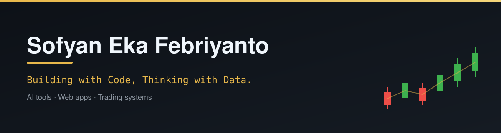

  

  

  
  
  

Developer from Indonesia. I build AI tools, web apps, and trading systems, mostly with Go, Laravel, and Flutter.

## 🚀 What I'm building

<table>
  <tr>
    <td>
      
    </td>
    <td>
      
    </td>
  </tr>
</table>

- **Kantor AI** — an AI team as a service for creators and agencies. [tim.sefy.my.id](https://tim.sefy.my.id)
- **Kenfa** — e-commerce for a fashion brand: Laravel + WordPress/WooCommerce with Midtrans payments.
- **Trade Journal** — self-hosted trading journal with broker sync, P&L calendar, and trade replay. [jurnal.sefy.my.id](https://jurnal.sefy.my.id)

<b>More about what I'm building</b>

- **Noir** runs on Go, with memory, tools, and voice.
- **Kantor AI** has five agents: PM, backend, frontend, QA, and research.
- **Trade Journal** syncs with the broker and can replay trades.

## 🛠 Tech stack

  

## 📊 GitHub stats

<table>
  <tr>
    <td></td>
    <td></td>
  </tr>
</table>

  

## 📈 Activity

## 🎯 Currently focused on

- AI agents and automation
- Go backends and self-hosted infra
- Systematic trading (XAUUSD)
